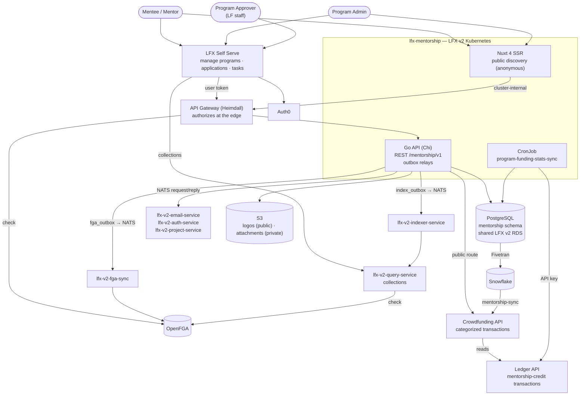

<!--
Copyright The Linux Foundation and each contributor to LFX.
SPDX-License-Identifier: MIT
-->

# LFX Mentorship — Architecture

**Scope of this file.** This is not the internal design of the Go service or the Nuxt app — it is
the **cross-component contract**: how Mentorship plugs into the rest of the LFX platform, who is
allowed to do what, and which services own what.

**This file describes the target architecture**, not the state of the build. Build and rollout
status lives in [`docs/heimdall-fga-implementation.md`](docs/heimdall-fga-implementation.md) and
[`docs/rewrite/blockers.md`](docs/rewrite/blockers.md), so that this file stays stable as the code
moves. The one exception is §6, which lists the contracts that are not settled yet, so that nobody
builds against them.

Companion documents, all narrower than this one:

| Document | Purpose |
|---|---|
| [`docs/rewrite/00-current-authz-relations.md`](docs/rewrite/00-current-authz-relations.md) | The legacy authorization baseline the new model is validated against |
| [`docs/rewrite/01-current-system.md`](docs/rewrite/01-current-system.md) | The legacy platform being replaced |
| [`docs/rewrite/02-target-architecture.md`](docs/rewrite/02-target-architecture.md) | Full rewrite proposal (data model, object storage, repo layout, scope exclusions) |
| [`docs/rewrite/03-migration-plan.md`](docs/rewrite/03-migration-plan.md) | Migration phases |
| [`docs/rewrite/04-authorization-model.md`](docs/rewrite/04-authorization-model.md) | **The FGA model** — types, relations, and the Postgres/FGA split |
| [`docs/rewrite/05-heimdall-gateway.md`](docs/rewrite/05-heimdall-gateway.md) | The gateway edge that consumes it |
| [`docs/rewrite/06-route-matrix.md`](docs/rewrite/06-route-matrix.md) | **The per-route matrix** — every route's authenticator, authorizer, object extraction and relation; the implementation contract for the RuleSets |
| [`docs/rewrite/07-email-delivery.md`](docs/rewrite/07-email-delivery.md) | The transactional email rail |
| [`docs/rewrite/08-prod-migration-runbook.md`](docs/rewrite/08-prod-migration-runbook.md) | Production data migration runbook |
| [`docs/fga-contract.md`](docs/fga-contract.md) | The messages this service publishes to fga-sync |
| [`backend/docs/indexer-contract.md`](backend/docs/indexer-contract.md) | The documents this service publishes to the indexer |
| [`CLAUDE.md`](CLAUDE.md) | Conventions for working in this repo |

Where the code, the spec directory, or `docs/rewrite/` contradict the *contract* stated here, that is
a defect in one of them — say so in review rather than letting the drift stand.

---

## 1. System context

**Two front ends, one API.** The public Nuxt site is anonymous: discovery and program pages only.
Applying, enrolling a program and every other signed-in action happen in LFX Self Serve, which owns
sign-in; the Nuxt site links there. Both call the same API through the gateway — the Nuxt server
through its cluster-internal address (`05` GW-3) — and there is no separate admin API. This
split is why the FGA model carries a public wildcard on programs (§3.2).

**The external path is `/mentorship/v1`.** On the shared gateway host, `/v1/users` and
`/v1/programs` are too generic to claim at the root alongside other services, so the platform
surface is `https://lfx-api.{domain}/mentorship/v1/...`. The service mounts that prefix itself — no
Traefik rewrite and no bare `/v1` mount (`05` GW-1). Route tables in `05` and `06` write paths as
`/v1/...`; the deployed path always carries the `/mentorship` prefix.

---

## 2. Components owned by this repo

| Component | Runtime | Responsibility |
|---|---|---|
| `mentorship-api` | Go 1.25, Chi v5, pgx v5 | The entire REST surface (§1), all business rules, and the relays that drain the FGA, index and object-deletion outboxes |
| `mentorship-frontend` | Nuxt 4 SSR | Public, anonymous discovery site; links to Self Serve for applying and enrolling |
| `program-funding-stats-sync` | Go CronJob | Hourly refresh of `program_funding_stats` from the Ledger API |
| `migrate` | Go, Helm pre-install/pre-upgrade Job | Applies `db/migrations` before new pods serve traffic |
| `mentorship` schema | PostgreSQL | System of record |

Both services ship as in-repo Helm charts and are deployed by ArgoCD from
[lfx-v2-argocd](https://github.com/linuxfoundation/lfx-v2-argocd)
(`values/{global,dev,prod}/lfx-mentorship-{backend,frontend}.yaml`). A push to `main` publishes
`:development` images that dev tracks by digest; a `v*.*.*` tag publishes semver images and signed
OCI charts, which prod pins.

---

## 3. Authorization

This is the part of the architecture the rest of the platform most depends on getting right.

### 3.1 Agreed direction

Mentorship sits **behind the LFX v2 API Gateway (Heimdall), authorizing against OpenFGA**, from the
start — rather than shipping bespoke auth and retrofitting later. Decided in architecture review on
2026-09-03 with Eric Searcy and Jordan Evans. Consequences agreed in that review:

- **Applications are their own FGA type.** Not an attribute of a program.
- **There is no `mentorship_super_admin`.** LF staff reach everything through the existing
  project `writer` relation. A new global role for the same population would be redundant, and
  `writer` is already the population that can grant roles to others.
- **Program approval is not project-scoped.** Approval is performed by a single global population
  (currently one person), so it is a **global team membership check** on the approve endpoint —
  the same pattern used for SurveyMonkey template managers — not a relation on `project`.
- **A project-level program admin relation is needed** — `project#mentorship_program_admin`:
  someone who can manage *all* mentorship programs for a project, including creating new ones,
  without being a full project admin. It belongs in the Self Serve project permissions page
  alongside viewer/manager, not in a separate mentorship-only UI.
- **`task` is its own FGA type, parented on the application**, completing one inheritance chain
  project → program → application → task (`04` decision 2).

### 3.2 The FGA model lives in `04` and `06`, not here

**[`docs/rewrite/04-authorization-model.md`](docs/rewrite/04-authorization-model.md) is the single
source of truth for the types, relations, and lifecycle emissions,
[`06-route-matrix.md`](docs/rewrite/06-route-matrix.md) for the route-by-route mapping the RuleSets
implement, and [`docs/fga-contract.md`](docs/fga-contract.md) for the messages this service
publishes.** None of them is restated here. The model — four mentorship-owned types
(`mentorship_program`, `mentorship_application`, `mentorship_task`, `mentorship_approver_team`) plus
`mentorship_program_admin` and the computed `mentorship_program_creator` on the existing `project`
type — is in
[`model.fga`](https://github.com/linuxfoundation/lfx-v2-helm/blob/main/charts/lfx-platform/files/model.fga)
(added in [lfx-v2-helm#177](https://github.com/linuxfoundation/lfx-v2-helm/pull/177)).

What belongs in *this* document is the handful of properties that are cross-component contracts
rather than schema:

- **Program `viewer` carries a `[user:*]` wildcard, and it is load-bearing.** It is not "always
  public" — Mentorship sets the `update_access` message's `public` flag only while the program is
  `published`, and fga-sync turns that into a **per-object tuple**, removed when the program leaves
  `published`. It exists because the public Nuxt site's callers are anonymous, or hold no relation
  on the program yet: drop the wildcard and every discovery request is denied at the edge. Any
  model variant that removes it loses that UI.
- **Approval is held deliberately outside the program's own relations.** The decision route checks
  `member` on the static object `mentorship_approver_team:global`. Folding it into `writer` would let
  every program admin approve their own program, so `PATCH /programs/{uid}` must reject a `status`
  field rather than silently ignoring it.
- **Project `writer` reaches everything by inheritance**, three levels down to tasks. There is no
  `mentorship_super_admin`, per §3.1.
- **One service owns all tuples on an FGA object.** `project#mentorship_program_admin` is owned end
  to end by [lfx-v2-project-service](https://github.com/linuxfoundation/lfx-v2-project-service) —
  storage, the management API, and emission in its full-state `update_access`
  ([lfx-v2-project-service#127](https://github.com/linuxfoundation/lfx-v2-project-service/pull/127)).
  Mentorship only consumes the inherited `writer`, and emits tuples only on its own four
  `mentorship_*` types. `exclude_relations` was considered and is not the design (`04` AQ-4).
- **The backend makes no FGA queries, so a list that depends on FGA relations goes through Query
  Service** ([lfx-v2-query-service](https://github.com/linuxfoundation/lfx-v2-query-service), over
  the index this service feeds). The service serves only lists it can answer from Postgres without
  an access decision: fully public lists (published programs, publicly listable profiles) behind
  `allow_all`, `/me` lists of the caller's own rows, and lists nested under an object the edge has
  already checked (`05`, `06`). `/v1/me/programs` and `/v1/me/mentor-programs` are pending
  platform sign-off (§6).

### 3.3 Service-side invariants the edge cannot enforce

Heimdall authorizes the object named in the request. These checks therefore stay in the service,
and they are contracts rather than implementation details:

- **Parent-child invariants on parent-authorized routes.** Wherever the edge checks a relation on a
  *parent* object while the mutation targets a *child* by its own ID, the service must verify the
  child belongs to that parent — otherwise the edge authorized a different object than the one being
  mutated. Without it, a `writer` on program A passes the edge check and then mutates a member or
  skill of program B. This is referential integrity on the request, not an access decision, which is
  why FGA holds no tuple for it (`04` decision 7). It applies to every parent-authorized route,
  including any child resource added later.
- **Canonical UIDs on authorized routes.** Tuples are keyed by UID, so a RuleSet built from a raw
  `{id}` capture that may be a slug would check a nonexistent object and deny a valid URL.
  `GET /v1/programs/resolve/{id}` returns the canonical `program.ID` for this purpose (`06` rule 1).
- **`/me/*` never addresses another subject's object.** The target is derived from `principal`,
  never from request input. The one path-ID exception, `/v1/me/profiles/by-id/{id}`, checks in the
  handler that the row belongs to the caller (`02`).
- **The raw user, profile, application and task reads are gated, not filtered.** They leave the
  public group entirely rather than having fields stripped, because a blocklist rots the first time
  a column is added (`05` GW-8). `User.email`, `User.lfid` and `UserProfile.phone`, `address`,
  `demographics`, `socioeconomics` therefore never reach an unauthenticated route at all. Public
  directory routes serve purpose-built allowlist DTOs instead.
- **The anonymous route list is `06`, not a rule of thumb.** It is wider than the catalog: program
  reads by uid, terms, funding-stats, transactions, sponsors and the `GET /mentees/{id}` /
  `/mentors/{id}` directory details are all anonymous too.
- **Where a route is public but one field is not, redaction in the handler is correct.**
  `GET /v1/programs/{uid}/members` stays public with `Email` nil'd in the handler (`05` GW-9): the
  field is withheld from every caller the route admits, so splitting the route by audience would be
  wrong (`06`). Redaction is the exception for a single legacy invite artifact, not the general
  pattern — the general pattern is gating, above.

### 3.4 Authentication

- **Users sign in through LFX Self Serve** (Auth0, OAuth2 PKCE). The public Nuxt site has no
  sign-in.
- **The API accepts only Heimdall-issued JWTs**, validated against the cluster-internal Heimdall
  JWKS. The caller's Auth0 token terminates at Heimdall and never reaches this service. Identity is
  the `principal` claim, which is also the key for `user:{lfid}` tuples (`02`, `05`).
- **A human caller on an authenticated route needs a local `users` row.** The service resolves
  `principal` to `users.lfid` and answers `401` when there is none, except on `PUT /v1/me`, which
  creates it. Self Serve calls `PUT /v1/me` on that `401` and retries. Anonymous public routes and
  M2M principals skip the lookup (`05`).
- Self Serve obtains a token for the **shared gateway audience**
  (`https://lfx-api.{lfx.domain}/`) by silent secondary auth and forwards it — the mechanism it
  already uses for Crowdfunding. Behind Heimdall there is no per-service Auth0 audience to acquire:
  the service-specific `lfx-mentorship-backend` audience appears only on the Heimdall-issued token
  and is never requested by the caller (`02`, `05` GW-3).
- **Both mentor-invite routes** (`POST /v1/mentor-invites/{token}/accept` and `.../decline`)
  **require authentication**, and carry no FGA check — `allow_all` at the edge, because the invitee
  holds no relation on the program yet. Ownership is enforced in the service: the token HMACs the
  `(programID, userID)` pair, so it names its own subject, and the handler **rejects the request
  unless that subject matches the authenticated principal** (`04` AQ-7, `06`). This applies to
  decline exactly as it does to accept. Tokens do not expire, so this binding is the control:
  without it, `allow_all` would let any authenticated caller accept or decline a known invitation.
- **There is a total authentication bypass for local development, and it must never reach a deployed
  environment.** `DISABLED_MOCK_LOCAL_PRINCIPAL` sets a static principal and
  `ALLOW_MOCK_LOCAL_PRINCIPAL_BYPASS=true` arms it
  ([`jwt.go`](backend/internal/infrastructure/auth/jwt.go)); together they skip JWT validation
  entirely and every request runs as that principal. The chart
  ([`validate.yaml`](backend/charts/lfx-mentorship-backend/templates/validate.yaml)) refuses to
  render either key unless `allowLocalAuthBypass=true` is passed explicitly. That guard is the only
  thing standing between a stray values entry and an unauthenticated production API, so it is a
  cross-component contract, not a local convenience: **never set either key in an ArgoCD values
  file.**

---

## 4. External contracts

| Counterparty | Direction | Mechanism | Failure behavior |
|---|---|---|---|
| **Auth0** | inbound | Users sign in through Self Serve (OAuth2 PKCE); M2M callers use client credentials. Both tokens terminate at Heimdall (§3.4) | Requests rejected 401 at Heimdall |
| **lfx-v2-fga-sync** | Mentorship → NATS JetStream `lfx.fga-sync.*` | Transactional `fga_outbox`; the relay re-derives the payload from current Postgres state at send time ([`docs/fga-contract.md`](docs/fga-contract.md)) | Retried; failed markers are kept as dead letters and requeued by exact key (`outbox-repair`) |
| **lfx-v2-indexer-service** | Mentorship → NATS JetStream `lfx.index.*` | Transactional `index_outbox` of document snapshots, relayed with a service token ([`backend/docs/indexer-contract.md`](backend/docs/indexer-contract.md)); feeds Query Service (§3.2) | Retried |
| **lfx-v2-project-service** | Mentorship → NATS request/reply | Project slug, name and logo for a program's `lf_project_uid`. Also the owner of `project#mentorship_program_admin` (§3.2) | Program create or update fails; an unknown project is `400` |
| **lfx-v2-auth-service** | Mentorship → NATS request/reply | LF account lookup by email or username, for mentor invitations | `ErrUpstreamUnavailable` |
| **lfx-v2-email-service** | Mentorship → NATS `lfx.email-service.send_email` | The platform rail for all transactional email: a request/reply relay over Amazon SES, imported as `lfx-v2-email-service/pkg/api`. It accepts **pre-rendered** `html`/`text` only — no templating — so Mentorship owns and renders its own templates (`07`). Not Mandrill: that is the legacy rail and is out of scope ([linuxfoundation/lfx-self-serve#2188](https://github.com/linuxfoundation/lfx-self-serve/issues/2188)) | Log and continue — a failed send must not fail the business operation |
| **Ledger API** | Mentorship → Ledger | Hourly CronJob, `LEDGER_API_KEY` bearer token; reads each program's credit and debit transactions (the Ledger project ID is the program ID) and caches amount raised and spent in `program_funding_stats`. **Direct, not proxied** — `LEDGER_BASE_URL` points at the Ledger service itself ([`clients/ledger.go`](backend/internal/infrastructure/clients/ledger.go)) | Last cached values served |
| **Crowdfunding API** | Mentorship → CF → Ledger | Request-time call from `ProgramService` to CF's public (anonymous) gateway route `/crowdfunding/initiatives/{id}/transactions`; no token is sent ([`clients/crowdfunding.go`](backend/internal/infrastructure/clients/crowdfunding.go)). CF reads the Ledger and adds what a raw Ledger transaction lacks: donor metadata and the organization/individual split. The initiative ID is the program ID, which CF's `mentorship-sync` also uses as its `initiatives.id`. Sponsor cards aggregate those same transactions locally (`aggregateProgramSponsors`) | `ErrUpstreamUnavailable` |
| **Snowflake** | Mentorship → SF → CF | Fivetran Postgres connector; `fivetran_mentorship_*` dbt models repointed. Crowdfunding reads Mentorship data from here (`mentorship-sync`, `03` OQ-2) | Analytics-plane only — never in the serving path |
| **S3** | Mentorship → S3 | Program logos in a public bucket behind CloudFront, task submissions in a private one. Uploads go through the API, not presigned URLs; IRSA when deployed (`02` §object storage) | Upload fails; deletes are queued (`object_deletions`) and retried |
| **LFX Self Serve** | SS → Mentorship | User token against `/mentorship/v1` on the shared gateway host (§1) | — |

Two Ledger paths, not one: the cache job calls the Ledger directly with an API key, and the
request-time call goes through Crowdfunding. Do not implement against the wrong one.

**Direction of dependency matters, and it is asymmetric — state both halves:**

- **Crowdfunding does not depend on Mentorship at request time.** It consumes Mentorship data only
  through the Snowflake batch feed (`03` OQ-2), so nothing in *Crowdfunding's* serving path waits on
  this service.
- **Mentorship does depend on Crowdfunding at request time.** `GET /v1/programs/{id}/transactions`
  and `/sponsors` call Crowdfunding synchronously and return `ErrUpstreamUnavailable` when it is
  absent. Both are **public** routes, so a Crowdfunding outage degrades unauthenticated pages.

Treat Crowdfunding as a live serving-path dependency for those two endpoints, and keep it out of the
path for everything else. Funding *stats* are the safe pattern — cached by the CronJob and served
stale rather than fetched inline.

---

## 5. Data ownership

PostgreSQL (shared LFX v2 RDS) is the system of record, replacing 8 DynamoDB tables and 30 GSIs.
Full ERD in
[`docs/rewrite/02-target-architecture.md`](docs/rewrite/02-target-architecture.md#data-model-proposal-level-erd).

Cross-component notes:

- **Users are mirrored, not owned.** `users.lfid` holds the LFID
  ([`001_initial.up.sql`](backend/db/migrations/001_initial.up.sql)). Auth0/LF SSO remains
  authoritative for identity.
- **`programs.lf_project_uid` is the project join key**, and the FGA parent tuple
  `mentorship_program#project@project:{uid}` is derived from it — so every inherited permission in
  §3.2 depends on it. Program creation requires it and validates it against Project Service. The
  target is `NOT NULL`. The column stays nullable only until the legacy programs the importer could
  not map (`UNMAPPED_PROGRAM`) are resolved (`02`, `03`); until then such a program inherits nothing
  from a project. `cii_project_id` is a *different*, legacy identifier and is not a substitute for
  it.
- **`program_funding_stats`** is a cache, never authoritative. It may be stale.
- **Search.** Elasticsearch is dropped from scope. Platform-wide search is Query Service over the
  index this service feeds; in-service filtering is Postgres (§6).
- **FGA tuples and index documents are emitted through transactional outboxes**, because a
  Postgres commit and a NATS publish cannot be made atomic. The two differ on retry:
  - The **FGA** outbox stores a dirty-object marker, and the relay re-derives the payload from
    current Postgres state at send time. It never replays a stored payload: the `GenericFGAMessage`
    envelope carries no object version, so a stale full-state payload retried after a newer
    revocation would restore exactly the tuple that was revoked.
  - The **index** outbox stores a document snapshot built in the enqueueing transaction, and the
    relay publishes that snapshot. A retry does not rebuild it from current rows; a later change
    enqueues a newer snapshot.

---

## 6. Contracts not settled yet

Listed so that nobody builds against them.

| Contract | What is open |
|---|---|
| **`/v1/me/programs` and `/v1/me/mentor-programs`** | Served by the service as exceptions to the Query Service rule (§3.2), pending platform sign-off: they need grouping and counts the program index document does not carry (`06`) |
| **Approver-roster administration** | `/v1/admin/approver-team/members` exists but is cluster-local, behind a backend scope check, and not routed through the gateway. Exposing it needs a platform LF-staff relation that is not yet approved, and the roster has no named owner (`04` AQ-8, `06`) |
| **Postgres full-text search** | `02` targets `tsvector` + GIN; no migration has them and in-service search uses `ILIKE`. Nothing may assume full-text semantics such as ranking or stemming |
