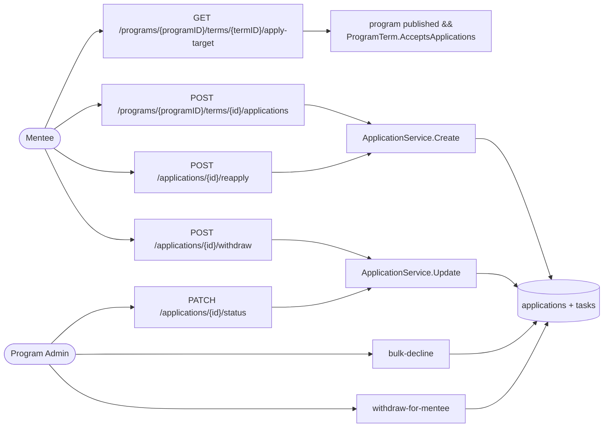
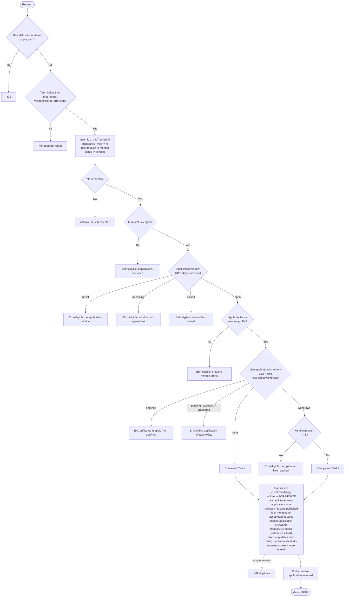
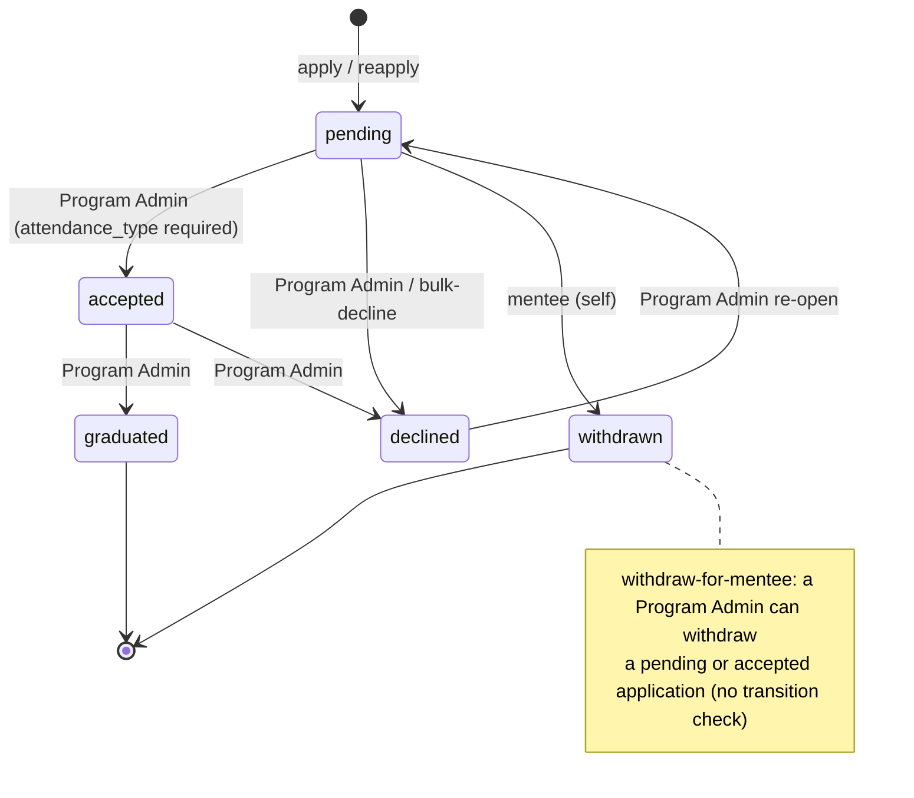

# LFX Mentorship – Apply Business Rules (Backend)

Current behavior of the `lfx-mentorship` backend (Go · Chi · Postgres), with a comparison to the legacy jobspring rules and a record of the gaps found in review and how each was resolved.

Sources:

- `backend/internal/service/application_service.go` (`Create` L258, `Update` L396, transitions L130, `requireProgramAdmin` L110)
- `backend/internal/handler/application_handler.go` (`Create` L316, `Reapply` L289)
- `backend/internal/handler/program_term_handler.go` (`GetApplyTarget` L130)
- `backend/internal/domain/models/program_term.go` (`ApplicationWindow` L63, `DiscoveryLabel` L86, `AcceptsApplications` L103)
- `backend/internal/infrastructure/db/application_repository.go` (`CreateWithTasks` L307, `ReapplyWithTasks` L347, `checkCanApply` L412, `checkMenteeAvailable` L435, `Update` L559, `FindByTermAndUser` L986)
- `backend/db/migrations/001_initial.up.sql` (`uq_applications_active` L207), `003_drop_hold_status.up.sql`
- `backend/charts/lfx-mentorship-backend/templates/ruleset.yaml` (Heimdall / OpenFGA rules)
- `docs/rewrite/04-authorization-model.md` (`mentorship_application` relations), `docs/rewrite/06-route-matrix.md`
- `specs/001-mentorship-core-workflow/spec.md` (FR-016, FR-017, FR-023, FR-025 – FR-042)

Application statuses: `pending`, `accepted`, `declined`, `withdrawn`, `graduated`. Roles: `mentee`, `mentor`. Only mentees apply; `mentor` rows exist only as applications imported from legacy.

On `mentorship_application`, `manager` resolves to the program's writers, so it holds for **Program Admins only**. Mentors aren't included (decision 6 in `04-authorization-model.md`).

---

## Endpoints

| Route | Gateway check (OpenFGA) | Purpose |
|---|---|---|
| `GET /v1/programs/{programID}/terms/{termID}/apply-target` | anonymous, `viewer` on program | Apply-page header: names and `accepting_applications` |
| `POST /v1/programs/{programID}/terms/{id}/applications` | `viewer` on program | Apply as a mentee (also reapplies when there is no live application and the latest is `withdrawn`) |
| `POST /v1/applications/{id}/reapply` | `mentee` on application | Reapply to the term of your own application |
| `POST /v1/applications/{id}/withdraw` | `mentee` on application | Mentee self-withdraw |
| `POST /v1/applications/{id}/withdraw-for-mentee` | `manager` on application (Program Admin) | Staff-assisted withdraw |
| `PATCH /v1/applications/{id}/status` | `manager` on application (Program Admin) | Status change |
| `POST /v1/programs/{programID}/terms/{id}/applications/bulk-decline` | `writer` on program | Decline all `pending` in a term |
| `DELETE /v1/applications/{id}` | `manager` on application (Program Admin) | Delete |

The applicant has no route that edits an application. Its dates come from the term, and every other field has a dedicated route above.

`viewer` on a program is a wildcard tuple that fga-sync writes only while the program is public. For anyone who isn't an auditor, a `viewer` check therefore also means the program is visible.

Behind the gateway, the service trusts Heimdall's check. Off the gateway (local auth only), it repeats each route's relation: status changes, delete, bulk decline and assisted withdrawal need an active Program Admin, and the reviewer note and evaluation need an active Program Admin or mentor.

---

## 1. Apply / Reapply flow

Both `POST .../applications` and `POST /applications/{id}/reapply` call `ApplicationService.Create`. The reapply route only uses `{id}` to resolve the term and role. Which application it reapplies from is decided by `FindByTermAndUser`, exactly as on the apply route.

### Rules (in order)

| # | Rule | Where | Fail |
|---|---|---|---|
| 1 | Caller authenticated and holds `viewer` on the program | Heimdall, handler L317 | 401 / 403 |
| 2 | Term belongs to `programID` in the URL | `validateNestedTermScope` | 404 |
| 3 | Applicant is always the JWT principal; body `user_id` is ignored | handler L333 | — |
| 4 | `attendance_type` from body is dropped (a Program Admin sets it on accept) | handler L335 | — |
| 5 | `role` defaults to `mentee` and must be `mentee`; mentors request to join through `POST /programs/{id}/members` (FR-023) | service L266–268 | 400 |
| 6 | Status is always `pending` on create | service L274 | — |
| 7 | Term `status = open` | service L282 | ErrIneligible |
| 8 | Today is inside the application window: both dates set, compared by UTC calendar day, both days inclusive | service L285 (`ProgramTerm.ApplicationWindow`) | ErrIneligible |
| 9 | The applicant has a mentee profile, which can only be created after confirming the eligibility criteria (FR-025, FR-028) | service L294 | ErrIneligible |
| 10 | The application that decides eligibility is the live (non-withdrawn) one for term + user + role, or else the latest withdrawn one | repo `FindByTermAndUser` L986 | — |
| 11 | That application is `declined` → no reapply | service L311 | ErrConflict |
| 12 | That application is `pending` / `accepted` / `graduated` → refuse | service L314 | ErrConflict |
| 13 | That application is `withdrawn` → reapply allowed while fewer than 3 are withdrawn for that term + role | service L322 + repo L393 (under lock) | ErrIneligible |
| 14 | Under the term lock: the term still takes applications now (rules 7–8 again) | repo `checkCanApply` L412 | ErrIneligible |
| 15 | Under the term lock: program `status = published` | repo `checkProgramPublished` L460 | ErrIneligible |
| 16 | Under a per-mentee lock: the applicant holds no `accepted` or `graduated` mentee application in any term | repo `checkMenteeAvailable` L435 | ErrIneligible |
| 17 | At most one non-withdrawn application per term + user + role | DB `uq_applications_active` | 409 |

Rules 7–8 are `ProgramTerm.AcceptsApplications`. The apply-target read reports `accepting_applications` as that rule AND program `published` (rule 15). The public discovery label and the catalog and platform-summary SQL (`sqlTermAcceptsApplications`) use the same window. `TestApplicationService_Create_WindowMatchesAcceptsApplications` and `TestProgramTerm_DiscoveryLabelMatchesAcceptsApplications` keep them aligned.

### What gets written (one transaction)

- New `applications` row (`pending`), with `program_term_status`, `start_date_time` and `end_date_time` copied from the term.
- On reapply, the old `withdrawn` row is **kept as history**, not modified.
- One `prerequisite` task per program task template: blank names skipped, `submitFile` kept only if `"required"`, `dueDate` kept only if `YYYY-MM-DD`.
- Outbox entries for access (FGA) update, search index, and program index refresh.

After commit, the mentee gets "application received".

---

## 2. Status transitions

| Rule | Where |
|---|---|
| Only transitions in `applicationTransitions` are allowed (except `withdraw-for-mentee`) | service L130 |
| Status write applies only if the row still has the status read before (optimistic check) | service L446 → repo L593 |
| Withdrawal through `withdraw` / `PATCH .../status` is applicant-only. Every other status change needs a Program Admin | service L430, L449 |
| `accepted` requires `attendance_type` (`full_time` / `part_time`) | service L454 |
| `accepted` requires the term to still be `open` (checked under lock) | repo L578 |
| Accepting a mentee refuses while they hold another `accepted` or `graduated` mentee application (per-mentee lock) | repo L582 |
| Moving into a blocking status (`pending`, `accepted`, `graduated`) is refused while the program is hidden | repo L597, L934 |
| Accepting a mentor application ensures an approved mentor membership | repo L627 |
| Tasks' `application_status` is synced on every status change | repo L631 |
| `withdraw-for-mentee`: a Program Admin can withdraw a `pending` or `accepted` application; `declined` and `graduated` are final and refused; an already `withdrawn` one is a no-op | service L574 |
| Bulk decline: only `pending` rows in the term become `declined` | repo L1021 |

Notifications:

- **Mentee applications.** The mentee is notified on `accepted`, `declined`, `withdrawn` and `graduated`, including bulk decline and assisted withdrawal. Assisted withdrawal skips the notice when the application was already `withdrawn`.
- **Mentor applications (imported from legacy).** Program Admins are notified when the mentor self-withdraws. The mentor is notified when a `pending` request is declined. Bulk decline and assisted withdrawal send nothing.

---

## 3. Comparison with legacy (jobspring)

| Rule | jobspring | lfx-mentorship |
|---|---|---|
| Applicant = authenticated user | ❌ on PUT re-apply | ✅ always |
| Term belongs to program | ❌ on PUT | ✅ |
| Term open + inside application window | ✅ (UTC day, end inclusive) | ✅ (UTC day, both days inclusive) |
| Missing window dates | treated as **not accepting** | treated as **not accepting** |
| Program must be published | — | ✅ |
| Mentee profile required | ✅ | ✅ |
| One `accepted` mentorship per mentee (checked at apply and at accept) | ✅ | ✅ |
| Block if mentee `graduated` anywhere | ✅ | ✅ (at apply and at accept) |
| Max 3 active (`pending`+`accepted`) applications | ✅ (inconsistent) | ❌ (FR-031: no cap on concurrent `pending`) |
| No reapply from `declined` (same term) | ✅ | ✅ |
| Reapply from `withdrawn` | reopens same row | new row, old kept as history |
| Limit on reapplies per term | — | ✅ max 3 withdrawn |
| Duplicate protection | check-then-write (racy) | unique index + term lock |
| Tasks + application in one transaction | ❌ | ✅ |
| `hold` status | paused accepted mentorship | dropped; legacy `hold` imports as `accepted` |

---

## 4. Gap fixes

A review of the apply flow found 13 gaps. All 13 are closed: 12 by a code change and one (gap 11) by confirming the spec's behavior. Four needed a product decision. They follow legacy parity, except gap 5, which follows FR-023:

| Decision | Outcome |
|---|---|
| `hold` status (gap 10) | Dropped, as `02-target-architecture.md` says. Spec FR-040 is struck |
| Graduated mentees (gap 3) | Blocked from applying again, as in legacy |
| Mentor applications through the apply route (gap 5) | Not allowed: the apply route is mentee-only |
| Application window (gaps 6, 7) | Legacy rule: both dates required, compared by UTC calendar day, both days inclusive |

### Summary

| # | Gap | Status | Fix |
|---|---|---|---|
| 1 | One accepted mentorship per mentee wasn't enforced | ✅ Fixed | Checked at apply and at accept, under a per-mentee lock |
| 2 | Assisted withdrawal of a `declined` application reopened reapplying | ✅ Fixed | `withdraw-for-mentee` refuses `declined` and `graduated` |
| 3 | Graduated mentees could apply to other terms | ✅ Fixed | Blocked by the same check as gap 1 |
| 4 | No mentee profile or eligibility check at apply | ✅ Fixed | A mentee profile is required |
| 5 | `role` came from the request body | ✅ Fixed | Apply route is mentee-only |
| 6 | Missing window dates: apply and discovery label disagreed | ✅ Fixed | Missing dates mean not accepting, everywhere |
| 7 | Window boundary differed from legacy (MENV2-1667) | ✅ Fixed | UTC calendar day, end day inclusive |
| 8 | `accepting_applications` ignored program status | ✅ Fixed | Also requires the program to be `published` |
| 9 | Window not re-checked inside the transaction | ✅ Fixed | Re-checked under the term lock |
| 10 | `hold` still a valid status | ✅ Fixed | Dropped; migration 003 |
| 11 | No cap on active applications | ✅ Kept by design | FR-031 allows concurrent applications |
| 12 | Applicant-supplied `start_date_time` / `end_date_time` | ✅ Fixed | Copied from the term; edit route removed |
| 13 | Service-side authorization disagreed with the gateway | ✅ Fixed | Off-gateway Program Admin checks |

### Details

**Gap 1: one accepted mentorship per mentee.**
- **Before:** nothing stopped a mentee from holding several `accepted` applications. Legacy enforced it, and `00-current-authz-relations.md:78` depends on it.
- **After:** a mentee application is refused, and so is its acceptance, while the user holds another `accepted` mentee application in any term. The check takes a per-mentee advisory lock: two acceptances in different terms lock different term rows, so only that lock serializes them. A partial unique index was rejected, because imported legacy data may already break the rule.
- **Code:** `checkMenteeAvailable`, called from `checkCanApply` (create, reapply) and from `Update` on accept (`application_repository.go`).
- **Tests:** `TestApplicationRepositoryIntegration_MenteeHoldsOneMentorship`, `TestApplicationRepositoryIntegration_ConcurrentAcceptancesOfOneMentee`, and e2e "a mentee holds one accepted mentorship".

**Gap 2: assisted withdrawal reopened reapplying.**
- **Before:** `withdraw-for-mentee` moved any status to `withdrawn`. Withdrawing a `declined` application let the mentee reapply to the term, against FR-030.
- **After:** `declined` and `graduated` are final outcomes and are refused with 409. `pending` and `accepted` can still be withdrawn. An already `withdrawn` application is a no-op.
- **Code:** `assistedWithdraw` (`application_service.go`).
- **Docs:** `00-current-authz-relations.md` decision 3, `04-authorization-model.md` decision 6, and `06-route-matrix.md`.
- **Tests:** `TestApplicationService_AssistedWithdrawal_RefusesFinalOutcomes`, and e2e "a declined applicant cannot reapply".

**Gap 3: graduated mentees could apply again.**
- **Before:** `graduated` blocked only the same term.
- **After:** as in legacy, a `graduated` mentee application in any term refuses new applications and acceptances.
- **Code:** same check as gap 1 (`menteeOutcomeStatuses`).
- **Tests:** `TestApplicationRepositoryIntegration_MenteeHoldsOneMentorship` (`graduated` case), and e2e "graduation".

**Gap 4: no mentee profile or eligibility check.**
- **Before:** `Create` didn't look at the applicant's profile.
- **After:** `Create` requires a mentee profile, which can only be created after the eligibility criteria are confirmed. This enforces FR-025/026 and FR-028.
- **Code:** `ApplicationService.Create`, through the new `UserProfileRepository` dependency.
- **Tests:** `TestApplicationService_Create_RequiresMenteeProfile`, and e2e "create validation".

**Gap 5: `role` from the request body.**
- **Before:** any program `viewer` could create a mentor application, and accepting it granted an approved mentor membership.
- **After:** `role` defaults to `mentee`, and anything else is a 400. Mentors request to join through `POST /programs/{id}/members` (FR-023). Mentor applications imported from legacy can still be decided. The mentor branch of the "application received" notification is removed.
- **Docs:** `06-route-matrix.md` and `07-email-delivery.md`.
- **Tests:** `TestApplicationService_Create_MenteeOnly`, and e2e `TestE2EMentorApplication`.

**Gap 6: missing window dates.**
- **Before:** submit treated a missing date as open, while the discovery label treated it as closed.
- **After:** as in legacy, a term missing either date takes no applications. One rule, `ProgramTerm.ApplicationWindow`, now backs submit, apply-target, the discovery label, the catalog and platform-summary SQL (`sqlTermAcceptsApplications`), and the frontend term badges (`frontend/app/utils/program-terms.ts`). The stale `DiscoveryLabel` comment is fixed.
- **Tests:** `TestProgramTerm_AcceptsApplications`, `TestProgramTerm_DiscoveryLabelMatchesAcceptsApplications`, `TestApplicationService_Create_WindowRefusals`, and `program-terms.test.ts`.

**Gap 7: window boundary.**
- **Before:** exact timestamps, so an end date stored at midnight closed at 00:00 on the advertised day.
- **After:** compared by UTC calendar day with both days inclusive. The window opens at 00:00 UTC on the start date and closes after 23:59:59 UTC on the end date, whatever time of day was stored.
- **Tests:** same as gap 6.

**Gap 8: apply-target ignored program status.**
- **Before:** a Program Admin viewing an unpublished program's open term saw `accepting_applications: true`, but submitting failed.
- **After:** `accepting_applications` also requires the program to be `published`.
- **Code:** `GetApplyTarget` (`program_term_handler.go`).
- **Tests:** `TestProgramTermHandler_GetApplyTarget_UnpublishedProgramNotAccepting`.

**Gap 9: window not re-checked under lock.**
- **Before:** only `term.status` was re-checked inside the transaction.
- **After:** `checkCanApply` re-checks `AcceptsApplications` under the term lock, for both create and reapply. `ReapplyWithTasks` now reads the whole term row.
- **Tests:** `TestApplicationRepositoryIntegration_CreateUsesTermWindowAndDates`.

**Gap 10: `hold` status.**
- **Before:** `hold` was in the model, the transition map and the CHECK constraint. Spec FR-040 required it; `02-target-architecture.md` said it should be dropped.
- **After:** removed from the model, the transitions, the applicants-list sort order and the mentor-decline notice. Migration `003_drop_hold_status.up.sql` tightens `applications_status_check` and rewrites any `hold` row, and its tasks' copy of the status, to `accepted`. The legacy import and the import checker map legacy `hold` (a paused accepted mentorship) to `accepted`.
- **Docs:** FR-040 is struck, and `spec.md`, `data-model.md`, `contracts/api.md`, `research.md` C-3, `02-target-architecture.md` and `03-migration-plan.md` are updated.
- **Tests:** e2e "a declined applicant cannot reapply" (`hold` → 400), and `test_application_status_maps_legacy_values`.

**Gap 11: no cap on active applications.**
- **Before / after:** unchanged by design. FR-031 explicitly allows concurrent applications across programs; legacy's cap of 3 was applied inconsistently. The one-accepted rule (gap 1) is the limit that matters.

**Gap 12: applicant-supplied dates.**
- **Before:** `start_date_time` and `end_date_time` were saved from the apply body. The applicant could also change them later through `PATCH /applications/{id}`.
- **After:** both are copied from the term on create. They are gone from `ApplicationCreateInput` and `ApplicationUpdateInput`. `PATCH /applications/{id}` edited nothing else, so it is removed, together with its `applications-writer` Heimdall rule and its route-matrix row.
- **Tests:** `TestApplicationRepositoryIntegration_CreateUsesTermWindowAndDates`, and e2e "the applicant cannot edit the application" (405).

**Gap 13: service-side authorization.**
- **Before:** off the gateway, any approved mentor could change an application's status, which the gateway's `manager` relation forbids. `Delete` had no service-side check at all.
- **After:** a shared `requireProgramAdmin` check guards status changes, delete, bulk decline and assisted withdrawal off the gateway. The reviewer note and evaluation still admit mentors. Behind the gateway, Heimdall stays the authority, so a gateway principal skips the check.
- **Tests:** `TestApplicationService_AdminDecisionsRefuseMentors`, `TestApplicationService_Delete_ProgramAdmin`, and `TestApplicationHandler_AdminActionsPassPrincipalAsActor`.

### Verification

| Suite | Result |
|---|---|
| Backend unit tests (`go test ./...`) | Pass, except `internal/infrastructure/email`. That package fails only on a Windows checkout whose email templates have CRLF line endings, and was not changed |
| Frontend `program-terms.test.ts`, prettier, eslint | Pass |
| Legacy import tests (`backend/db/scripts`) | 158 passed, 24 skipped (need a database) |
| `make license-check` | Pass |
| Integration (`-tags=integration`) and e2e (`-tags=e2e`) | Compile and vet clean; to run in CI, which has Postgres |
| `golangci-lint`, `go test -race` | Not run locally; to run in CI |
